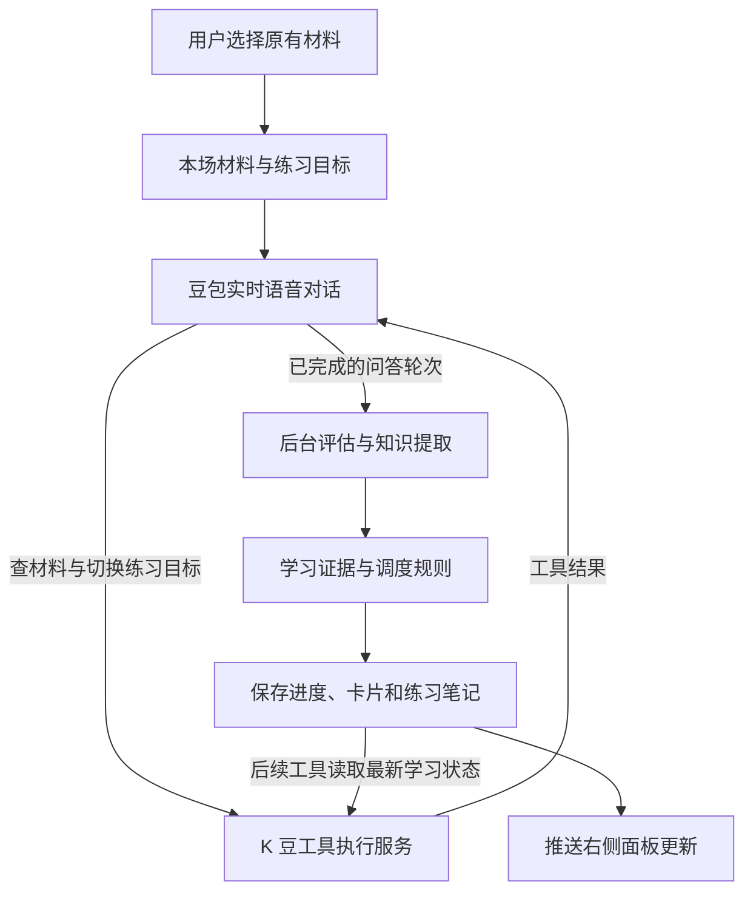

# K 豆语音学习 Agent：调研与可行性

调研日期：2026-10-27。范围：官方公开文档与当前仓库静态审查。尚未用当前账号执行真实语音、工具调用或费用测试；下文的覆盖判断和验收目标属于工程评估，不是实测结果。

## 结论

建议沿用现有豆包全双工链路，增加后端工具执行、逐轮学习评估和右侧学习面板。用户描述的「选择材料 → 语音复习 → 更新进度 → 新增知识卡片」具备实现条件，可以把七八成产品体验作为首版目标。

关键证据：当前豆包 Seeduplex 官方接口明确支持 Function Calling；其地址与固定模型值 `1.2.6.1` 和仓库默认配置一致。现有代码已接入语音协议，但未声明学习工具，也未处理函数调用事件。这里主要是补业务闭环，不必先替换语音供应商。[豆包全双工接口](https://docs.volcengine.com/docs/DoubaoVoice/endtoend-realtime-voice-full-duplex-version)

「功能可接入」不等于「掌握度判断已可靠」。真正需要试验的是英文学习者语音识别、工具触发稳定性、问答与卡片匹配、打断后的证据有效性，以及评估耗时。

## 市面上的实现方式

| 实现路径 | 工作方式与代表 | 对 K 豆的意义 |
| --- | --- | --- |
| 实时语音模型直接调用工具 | OpenAI Realtime、Gemini Live、豆包 Seeduplex：模型听说，并发出结构化函数调用，由应用执行 | 适合自然口语陪练，最接近现有代码 |
| 分段语音流水线 | 语音识别 → 文本 LLM / 工具 → 语音合成；LiveKit 同时支持这种流水线和实时语音模型 | 更容易独立替换识别、推理和声音模块，但需要额外编排 |
| 托管语音 Agent 平台 | Vapi 提供语音通话中的 HTTP 工具、函数回调、知识检索及界面事件 | 可参考工具与界面的连接方式，迁移要另评估平台接入与运营成本 |

这些方案的共性是：模型提出操作，业务服务执行并返回结果，界面订阅已执行的变化。应用自己的学习规则、数据归属和进度计算仍需实现。

对照官方资料：

- **OpenAI Realtime**：可配置函数工具及远程 MCP；函数工具由应用执行并回传结果。适合参考「语音对话调用业务接口」的闭环。[OpenAI Docs：Realtime with tools](https://developers.openai.com/api/docs/guides/realtime-mcp)
- **Gemini Live**：支持函数调用；异步能力随模型而异，不能笼统认为所有 Live 模型都能在工具执行时继续对话。[Google：Live API tools](https://ai.google.dev/gemini-api/docs/live-api/tools)
- **LiveKit**：支持分段流水线与实时语音模型，并支持后台工具、外部数据检索和前端 RPC。它是编排框架，不是另一个语音模型。[Models](https://docs.livekit.io/agents/models/)、[Tools](https://docs.livekit.io/agents/logic/tools/)
- **Vapi**：将通话中的工具请求送到业务服务器，也可触发浏览器事件。其服务端工具负责数据操作，客户端事件可负责展示；这里值得借鉴的是职责分工。[Vapi Tools](https://docs.vapi.ai/tools)、[客户端工具](https://docs.vapi.ai/tools/client-side-websdk)

本次聚焦可落地的 API 与架构，不依据消费端演示推断 API 能力，也不对供应商做未经实测的延迟或效果排名。

## 豆包能提供什么

官方全双工接口已经包含工具声明、调用事件及结果回传机制。调用事件携带 `call_id`，应用通过 `conversation.item.create` 回传对应工具结果，模型再继续回复。具体编码须按豆包协议实现，不能直接复制 OpenAI 的消息结构。[豆包全双工接口：Function Calling 与下行事件](https://docs.volcengine.com/docs/DoubaoVoice/endtoend-realtime-voice-full-duplex-version)

| 用户需要的能力 | 判断 | K 豆需要补的部分 |
| --- | --- | --- |
| 勾选原有材料开始对话 | 可实现 | 保存材料 ID、校验归属、生成本场材料摘要 |
| 从所选笔记中找内容复习 | 可实现 | 有范围限制的材料查询工具；少量材料先直接加载 |
| 练习中改变右侧卡片 | 可实现 | 后端发布卡片与练习状态事件，前端更新面板 |
| 按回答更新学习进度 | 可实现，质量需验证 | 逐轮证据、评估规则、持久化与复习调度 |
| 对话中新增知识卡片 | 可实现 | 卡片生成、来源记录、重复合并、质量校验 |
| 实时补充笔记 | 可实现，需新增存储能力 | 保存本场练习笔记，并以追加方式关联原材料 |
| 长期、准确的掌握度模型 | 首版只能近似 | 跨场次证据、提示依赖、复现能力和延迟复习 |
| 音素级发音评分 | 尚未证实 | 需要专用语音评测，不能用字幕准确率代替 |

本次未确认豆包工具具有与其他平台相同的非阻塞语义。设计上让查询与状态记录保持短小；耗时评估、制卡进入应用自己的后台任务。若先返回「已受理」，必须与「已保存成功」区分。

## 当前代码可复用的基础与缺口

以下路径均相对于仓库根目录。

| 已有基础 | 位置 | 仍需补充 |
| --- | --- | --- |
| 豆包全双工配置、后端代理及鉴权 | `backend/src/main/java/com/khankiddo/learning/config/VoiceRealtimeProperties.java`、`voice/VoiceRealtimeProxyHandler.java` | 服务端事件解析和工具分发；当前主要透传文本帧 |
| 麦克风采集、播放、字幕、打断及静音 | `frontend/src/composables/useVoiceRealtime.ts` | 学习业务事件交给独立 composable；避免继续加厚音频编排 |
| 本场提示词、练习历史、结束后送去分析 | `frontend/src/views/practice/VoicePracticeView.vue` | 材料选择、本场学习目标和右侧面板 |
| 练习会话与字幕保存 | `backend/src/main/java/com/khankiddo/learning/voice/VoicePracticeSessionService.java` | 后端可信的逐轮记录、问题与回答绑定、重连恢复 |
| 成长卡读取、评分及新增接口 | `backend/src/main/java/com/khankiddo/learning/controller/GrowthCardController.java` | 按勾选 ID 批量读卡、语音来源制卡、AI 评估入口 |
| 历史错句数据库工具、可选语义检索 | `backend/src/main/java/com/khankiddo/learning/ai/grammar/` | 适配实时语音工具协议，并加本场选择范围过滤 |

需要特别处理四个差异：

1. **现有进度是离散状态。** `GrowthCardScheduler` 使用 `unfamiliar / fuzzy / mastered` 和固定复习间隔，不是连续掌握百分比；`easy` 会直接标为掌握并退出队列。AI 首版应先记练习证据，再保守映射到已有调度，不能一答对就退出复习。
2. **现有制卡依赖分析来源。** `CollectGrowthCardRequest` 必填 `analysisId` 和 `sourceRef`；成长卡证据也围绕分析句子建立。语音中制卡要增加真实的会话与轮次来源，连同数据库约束、来源解析和历史展示一起扩展，不能伪造分析 ID。
3. **字幕不是足够的学习证据。** 当前前端会合并同角色字幕，且打断时可能保留已生成但尚未播完的内容。需要保存独立 turn ID、题目、目标卡片、提示使用情况、打断与播放状态。
4. **未发现独立的通用笔记实体。** 当前主要是分析记录、知识点与成长卡。首版可将这些作为可选材料，并新增关联它们的练习笔记；若产品里的「笔记」指独立笔记本，需补实体与列表能力。

已有 LangChain4j `@Tool` 不会自动成为豆包实时语音工具，需要显式适配。现有 DB Tools 还说明异步线程不能依赖请求线程的登录上下文；新工具也应从已鉴权会话显式获取用户身份。

## 推荐的产品与架构

以下为设计建议。

开始前，用户选择几张成长卡与相关分析材料，看到本场练习目标。服务端保存选择快照与材料版本，建立练习会话；首版可以从约 5–10 张卡起步，这只是控制试验范围的建议值。

进行中，左侧保持自然语音和字幕，右侧显示「正在练习」「本次表现」「待复习」「新增卡片」以及自动保存的本场笔记。每轮回答结束后更新一次，用户可以纠正评估、删除误生成内容。

两条处理路径的分工：

- **对话工具路径**：读取本场材料、聚焦卡片、响应用户「记一下」等明确要求；结果需要立即用于对话。
- **后台学习路径**：完整回答到达后，评估表达、记录证据、提取新知识并更新面板；避免每次都阻塞语音回复。这里的评估器只是一个后台模型调用，不要求引入多 Agent 框架。

状态需再提供给语音模型，否则会出现「右侧已更新，AI 仍按旧状态提问」。优先让下一次材料工具返回最新状态；必要时在轮次边界更新简短控制摘要，异步结果带版本，防止旧结果影响新问题。

### 首批工具边界

名称仅为建议，并非现有接口：

| 工具 | 职责 |
| --- | --- |
| `get_practice_materials` | 在本场勾选范围内读取卡片、知识点、相关笔记及最新状态 |
| `focus_practice_card` | 绑定当前卡片与题目，通知右侧聚焦；提供评估目标 |
| `record_practice_attempt` | 记录回答轮次及证据；服务端决定是否更新长期状态 |
| `create_learning_card` | 对明确提出的制卡要求保存卡片或提交制卡任务，返回真实处理状态 |
| `append_practice_note` | 保存关联原材料的补充笔记，保留来源；原笔记修改保留版本 |

自动评估和自动制卡还要由完成轮次事件触发，不能完全依赖模型记得调用工具。

服务端由会话决定用户、允许材料集合和写入范围。模型不能传入任意用户身份，也不能自行执行 SQL。工具调用按会话和 `call_id` 去重；学习证据按目标卡片与回答轮次去重，避免重试或跨路径处理导致重复评分。

对话事件可以沿现有 WebSocket 推送，但业务持久化成功后才通知「已保存」。新增独立事件处理与学习服务，代理只负责委托，遵守现有架构规则。

### 掌握度的具体处理

把「这次答得怎么样」和「这个知识点长期掌握了吗」分别保存。

一次练习记录应包含：目标知识点、实际题目、用户原话、是否有提示、是否被打断、判断理由、置信度、对应材料版本。无法确认识别结果或没有考到目标时，记录为不确定或未评估，不能默认判错。

例如复习 `used to`：

- 用户能在新情境中独立使用：记录一次成功证据。
- 在 AI 先给出答案后跟读：记录「有提示完成」，不算独立掌握。
- 用户说「我懂了」：不足以推进长期掌握度。
- 回答仍涉及习惯，却没有考察目标表达：不能只因未出现关键词就判错。

当前手动评分接口继续服务原有流程；新增语音评估策略先保守累计证据。展示可以使用「本场独立完成 2 次 / 提示后完成 1 次」，避免无依据的「掌握 87%」。知识点层面汇总也要单独建立用户学习状态，不能直接由一个卡片状态替代。

### 笔记与新增卡片

对话过程中生成结构化学习笔记并保存，允许用户继续说话。优先记录：重复犯错、用户主动询问的表达、复习中暴露的缺口。每张卡片应有一个明确学习目标、可练习的正面、解释与例句的背面，以及原话来源。

与已有卡片相同的知识优先追加练习证据或合并，避免每轮造一张同义卡。现有按分析来源去重的能力不足以解决跨会话语义重复，需要新的规范化与知识关联策略。

对原笔记采用追加补充与版本化修改；先存本场笔记，再关联到材料。语音 ASR 可能误识别，也可能把不规范表达转成规范文本，评估前需用真实学习者样本确认这一偏差。发音评分另设能力范围。

## 推荐推进顺序

### 第一步：验证最小闭环

选择少量真实卡片，连通一段「AI 查材料 → 用户回答 → 后端记录 → 面板变化 → AI 继续复习」的对话。先证明现有账号下工具与语音可以稳定配合，再铺完整页面。

必须观察：工具声明是否被接受、调用事件结构与回传格式、调用后能否恢复语音、工具期间插话的表现、连续多轮调用及异常处理。纯语音已连通不代表这些行为已经验证。

### 第二步：完成首版学习流程

- 勾选材料并保存会话快照，默认只在所选范围复习。
- 右侧展示目标卡片、练习证据、复习状态与本场笔记。
- 增加后台逐轮评估，保守写入已有成长卡状态。
- 支持自动/用户要求制卡，新增语音来源与去重。
- 结束时汇总进度、笔记和新卡，保留现有详细分析入口。

### 第三步：补足更成熟的体验

跨场次掌握度、自适应出题、独立通用笔记本、更多材料的语义检索、专门发音评测与更复杂的教学规划。这些不应作为第一步工具链验证的前置条件。

## 如何判断“做到了七八成”

七八成指核心用户流程覆盖，不能解读为掌握度判断准确率、性能保证或成本估计。建议用以下演示与样本验收：

| 检查项 | 首版验收方式 |
| --- | --- |
| 按勾选内容复习 | 复习问题能够追溯到所选卡片；越界材料不读、不写 |
| 实时进度 | 每次有效回答产生可解释的结果，刷新后仍存在 |
| 实时笔记和制卡 | 对话未结束即可看到保存内容，并能追溯到原话 |
| 识别与教学质量 | 使用含错误表达、中文夹杂、停顿及提示依赖的真实样本，由人核对 |
| 打断与重复调用 | 打断不丢旧记录、不误评新目标，重试不重复加分或制卡 |
| 状态一致 | 断线恢复、页面刷新、后台任务晚到，均能以持久化状态恢复 |
| 成本 | 实测语音、附加文本评估及检索的每场总消耗；保留已有额度硬停 |

可以将「有效回答完成到面板更新约 1–3 秒」作为第一轮产品目标，但这是待验证的目标。需要分别测语音首包、工具耗时、后台评估与界面更新的 P50/P95，再决定是否达到可用体验。

如果原生工具触发不稳定，仍可保留豆包听说，在后端基于完整问答触发学习操作。若后续需要严格控制每一次提问与评分，再比较分段流水线或更强的教学编排。当前没有证据要求先切换到另一家模型。

## 验证边界

本次完成文档调研与代码核对，未修改业务实现，也未运行真实语音或产生模型调用费用。当前账号的具体开通状态、并发限制、英文学习评估效果、端到端延迟与实际单价仍需在最小实验中确认。
