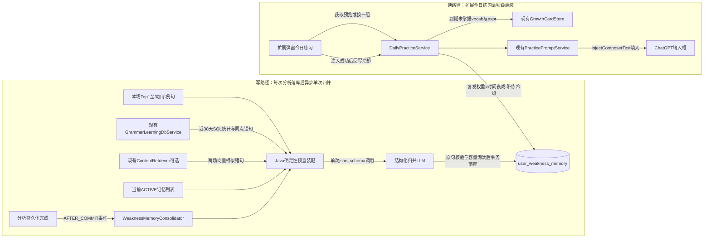

# 左脑薄弱点记忆沉淀与「今日练习」闭环 TODO

日期：2026-11-18  
状态：待实施（设计已对齐）  
范围：个人口语薄弱点记忆沉淀（`user_weakness_memory`：Java 确定性预查 + 单次结构化 LLM 归并）、跨对话「今日练习」选点与扩展一键注入、复盘中心记忆管理。  
关联：`docs/todo/connection/2026-11-13-roadmap.md`（承接其中「当前重点 / 下次练习推荐」的具体落地形态）、`docs/achieved/directed-practice-prompt/2026-08-25-todo.md`（复用提示词组装器）。

---

## 1. 总判断与产品边界

1. **只做「左脑（口语薄弱点演进记忆）」，不重造「右脑（生活背景与闲聊话题记忆）」**
   - 用户在自己的 ChatGPT 账号内练习口语，ChatGPT 原生 Memory 已经掌握用户的职业、日常背景与近期话题；KK 重复提炼生活记忆属于画蛇添足。
   - ChatGPT 原生记忆记不住、也管不好的，是**二语学习者具体的中式句法/搭配微习惯及其跨场演进**——这是 KK 记忆系统的唯一核心。
2. **为什么不能只靠纯 SQL 按** `habitKey` **统计**
   - `HabitCardScorer` 的 `habitKey` 多为语法家族级大桶（如 `FAM_TENSE`、`FAM_ARTICLE`、`FAM_NONFINITE`），纯 SQL 聚合只能得出「时态错了 N 次」，颗粒度过粗，无法指导具体开口自检。
   - 同一底层表达习惯在不同场次可能散落在相近 `pointId` 下，需要大模型结合历史统计与相似错句做语义归并，沉淀出具体微习惯（如 *「*`spend + 时间` *后常直接跟动词原形，漏* `-ing`*」*、*「*`whether/if` *从句前习惯误加定冠词* `the`*」*）。
3. **写时「Java 确定性预查 + 单次结构化 LLM 归并」，读时毫秒级查表拼装**
   - **不挂** `@Tool` **多轮循环**：分析刚完成时，本场 Top 1～3 的 `pointId / familyId` 和代表错句在 Java 里是 100% 已知的，无需包装成 Function Calling 让模型猜参数往返 2～4 轮；直接由 Java 一次性预查好 SQL 统计、同点历史错句与 Qdrant 相似错句拼进上下文，**固定 1 次** `json_schema` **结构化 LLM 调用**完成归并，Java 统一做例句防伪校验并事务落库。
   - **Qdrant 错句向量库维持现状**：现有 `GrammarErrorIndexer` 本来只索引本场报错句（不含正确原句），体量极小；**不裁剪为仅索引 Top 3**，以保留「跨场单次出现、尚未达到当场 2 次阈值」的隐性复发线索，并保证 `/review?chat=1` 复盘问答检索完整。
   - **读取时机 0 LLM**：打开扩展或点「换一组」时，纯 Java 毫秒级查询记忆表 + 到期词汇成长卡，复用 `PracticePromptService` 组装两段式教练指令。

**本轮明确不做：**

- 通用生活/职业/闲聊话题事实记忆抽取，不引入 Mem0 / Zep / 图数据库；
- 写入时塞入整场全部用户原句做全量正向逐句扫描；
- 在后台记忆沉淀链路使用多轮 Function Calling 或写 Tool。

---

## 2. 整体数据流



---

## 3. 数据模型：`user_weakness_memory`

单表管理用户的活跃与归档薄弱点记忆。建表语句合入 `backend/src/main/resources/sql/DDL.sql` 单源（同步维护 `schema-test.sql` 与已有库升级脚本说明）。

```sql
CREATE TABLE IF NOT EXISTS `user_weakness_memory`
(
    `id`                 BIGINT AUTO_INCREMENT PRIMARY KEY,
    `user_id`            BIGINT       NOT NULL COMMENT '所属用户 ID',
    `title`              VARCHAR(120) NOT NULL COMMENT '具体微习惯短标题，供扩展预览与教练目标使用',
    `diagnosis`          VARCHAR(500) NOT NULL COMMENT '成因诊断（为什么总这样说）',
    `coaching`           VARCHAR(500) NOT NULL COMMENT '开口前自检提示（怎么改）',
    `anchor_habit_key`   VARCHAR(64)  NULL COMMENT '关联字典 habitKey（如 FAM_TENSE 或叶子 pointId）',
    `anchor_point_id`    VARCHAR(64)  NULL COMMENT '代表知识点叶子 pointId',
    `bad_example`        TEXT         NOT NULL COMMENT '真实用户原错句（必须经历史记录核验）',
    `target_rewrite`     TEXT         NOT NULL COMMENT '对应自然改写句',
    `source_analysis_id` VARCHAR(64)  NOT NULL COMMENT '最新一次更新该记忆的分析 ID',
    `hit_count`          INT          NOT NULL DEFAULT 1 COMMENT '累计归并/复发次数',
    `practiced_count`    INT          NOT NULL DEFAULT 0 COMMENT '被选入今日练习注入的次数',
    `status`             VARCHAR(20)  NOT NULL DEFAULT 'ACTIVE' COMMENT 'ACTIVE | ARCHIVED',
    `last_seen_at`       DATETIME     NOT NULL COMMENT '最近一次在分析中出现的时间',
    `last_practiced_at`  DATETIME     NULL COMMENT '最近一次注入练习的时间（用于冷却轮换）',
    `created_at`         DATETIME     NOT NULL DEFAULT CURRENT_TIMESTAMP,
    `updated_at`         DATETIME     NOT NULL DEFAULT CURRENT_TIMESTAMP ON UPDATE CURRENT_TIMESTAMP,
    INDEX `idx_weakness_mem_user_status` (`user_id`, `status`, `last_seen_at`),
    INDEX `idx_weakness_mem_source_analysis` (`user_id`, `source_analysis_id`)
) ENGINE = InnoDB COMMENT ='用户口语薄弱点长期记忆';
```

### 容量与数据卫生规则

1. **有界活跃池**：每人 `status = 'ACTIVE'` 条数上限默认 `12`（由 `WeaknessMemoryProperties` + `application.yml` 单源配置）。新增超限时，自动将「`hit_count` 最低且 `last_seen_at` 最早」的活跃项转为 `ARCHIVED`。
2. **例句真实性校验**：写入/更新的 `bad_example` 必须能在当前用户本场或历史 `conversation_analysis_item.original_sentence` 中匹配到（忽略首尾空白），拒绝模型凭空编造例句。
3. **删除分析联动**：监听分析删除事件（与 `GrammarErrorDeletedEvent` 同机位），若某条记忆的 `source_analysis_id` 被删除，则清理该条记忆（避免保留用户已删除对话中的原句）。

---

## 4. 写路径：Java 预查装配 + 单次结构化归并

### 4.1 触发与边界

- 在分析持久化事务提交后发布事件，`WeaknessMemoryConsolidationListener` 使用 `@TransactionalEventListener(phase = TransactionPhase.AFTER_COMMIT)` 在虚拟线程异步执行（若启用了 Qdrant 错句索引，确保预查时排除本场 `analysisId` 自身以免同句自命中）。
- 若本场 `HabitCardScorer` 产出的 `actionCards` 为空（无明显重复习惯错误），直接跳过，不消耗 LLM 额度。
- **老账号冷启动**：当登录用户首次请求「今日练习」且 `user_weakness_memory` 为空，但名下已有历史分析记录时，后台自动取最近一场含行动卡的分析异步触发一次种子沉淀，并返回本场即时回退预览，避免老用户首次体验为空。

### 4.2 Java 确定性预查上下文（极简控长）

无需 Function Calling，Java 直接复用底层服务一次性组装三块紧凑输入：

1. **当前** `ACTIVE` **薄弱点记忆列表**：`id`, `title`, `anchorHabitKey`, `hitCount`, `badExample`。
2. **本场 Top 1～3** `ActionCardDto`：`habitKey`, `pointId`, `title`, `diagnosis`，以及每张卡最多 3 条代表错句 `originalSentence -> suggestion`。
3. **针对每张 Top 卡自动预查的跨场证据**：
   - 调用现有 `GrammarLearningDbService`：查该卡关联 `pointId / familyId` 在近 30 天的命中频次与最近最多 `3` 条历史同点错句（排除本场）；
   - 调用现有语法错句 `ContentRetriever`（`ObjectProvider` 可选注入，未开 Qdrant 时跳过）：拿该卡代表原句检索最多 `3` 条跨场向量相似错句（排除本场）。

### 4.3 单次结构化输出与落库护栏

- 复用项目现有 `StructuredOutputPolicy` / `json_schema` 严格结构化输出能力，固定 **1 次 LLM 调用**返回归并决策列表 `operations[]`：
  - `MERGE`：指定已有 `memoryId` 归并刷新（`hit_count + 1`，更新 `last_seen_at`、`source_analysis_id`、最新例句与诊断微调）；
  - `CREATE`：新建一条具体微习惯记忆（仅当本场确属值得追踪的模式时创建，避免把纯口误写入长期记忆）；
  - `SKIP`：本场某项无需更新长期记忆。
- Java 层校验 `memoryId` 归属当前用户、校验 `badExample` 原句真实存在、执行活跃池上限淘汰后在单事务内落库；任何异常捕获记日志，不影响主分析与成长卡铸造。

---

## 5. 读路径：排序、冷却轮换与「今日练习」组装

### 5.1 薄弱点选点与轮换算法（纯 Java 确定性计算）

对用户所有 `ACTIVE` 记忆计算优先分（参数收口 `WeaknessMemoryProperties`）：

- **复发分**：`1 + ln(hitCount)`
- **时间衰减**：按距 `last_seen_at` 的天数指数衰减（如半衰期 21 天），长期未再犯的旧病灶自然沉底
- **带练冷却惩罚**：若 `last_practiced_at` 之后用户尚未产生新的分析（或距上次带练不足 `cooldownAnalyses = 2` 场 / `cooldownHours = 24` 小时），施加显著减分，优先轮换其它活跃病灶；若用户仅有 1 条活跃病灶则仍保留可用
- **换一组**：接口支持传入 `excludeMemoryIds` 与 `excludeCardIds`，在候选池中跳过已展示项重新取下一组

默认每次选取：

- **薄弱点（Goals）**：最多 `2` 条（默认优先 `1` 条主病灶，候选充足时最多 `2` 条，映射为 `PracticePromptRequest.Goal`）
- **到期表达（Vocabulary）**：从 `GrowthCardStore` 选取未掌握且到期的 `vocab` / `expr` 卡最多 `2` 条（映射为 `PracticePromptRequest.Vocabulary`）
- **无数据兜底**：新用户既无薄弱点记忆也无到期表达时，返回标记 `empty = true` 及轻量通用口语开场提示词，不抛错。

### 5.2 接口设计（薄 Controller）

| 方法 | 路径 | 职责 |
| --- | --- | --- |
| `POST` | `/api/practice/daily/recommend` | 入参可选 `excludeMemoryIds` / `excludeCardIds`；返回本次选中的薄弱点摘要、表达摘要与 `PracticePromptService` 组装好的 `prompt` |
| `POST` | `/api/practice/daily/mark-practiced` | 扩展成功填入 ChatGPT 输入框后调用，传入本次 `memoryIds`，更新 `practiced_count + 1` 与 `last_practiced_at`（仅点「换一组」不调用） |
| `GET` | `/api/weakness-memories` | 查询当前用户的薄弱点记忆列表（按 `ACTIVE` / `ARCHIVED` 分组） |
| `PATCH` | `/api/weakness-memories/{id}` | 手动归档（标为已掌握 `ARCHIVED`）或恢复为 `ACTIVE` |
| `DELETE` | `/api/weakness-memories/{id}` | 删除单条薄弱点记忆 |

---

## 6. 扩展与前端交互边界

1. **Chrome 扩展弹窗（替换原静态** `injectionSection`**）**
   - 将写死的「注入示例」升级为 **「今日练习」**：
     - 未连接账号时：隐藏或提示先连接账号；
     - 已连接时：展示 1～2 行紧凑摘要（例：`练：spend + 时间后漏 -ing · 2 个表达`），不再直接铺开大段英文原始指令；
     - 操作按钮：**「注入到输入框」**（复用 `injectComposerText` 填入当前 ChatGPT 输入框，成功后调 `mark-practiced`；不覆盖已有草稿，不自动发送）+ **「换一组」**（传 `excludeIds` 拉下一组）。
2. **网站复盘中心（**`/review`**）**
   - 新增「薄弱点记忆」轻量区块/抽屉：展示每条活跃微习惯的标题、累计复发次数、代表错句/改写，支持一键标「已掌握（归档）」与删除。

---

## 7. 架构守门对照（`AGENTS.md`）

- **R1 禁止加厚上帝类**：不在 `ConversationAnalysisServiceImpl`、`GrowthCardMintGateway`、`AnalysisDetailView.vue` 堆新逻辑；新增独立包 `weaknessmemory/` 与 `dailypractice/`，分析完成/删除仅通过 Spring 事件衔接。
- **R2 / R3 策略与公共逻辑复用**：结构化输出复用现有 `*StructuredOutputPolicy`；DB 统计与向量检索直接复用 `GrammarLearningDbService` 与 `GrammarErrorSemanticRetrieverConfig` 的 Retriever Bean（使用 `GrammarRagQuerySupport` 构造按用户过滤的 `Query`）；空判断统一用 `CollectionUtils` / `StringUtils` / `ObjectUtils`；登录态统一用 `SecurityUtils`；提示词拼装统一走 `PracticePromptService`。
- **R4 配置单源**：活跃池上限、预查历史天数/条数、衰减半衰期、冷却场次/时长、每次推荐条数全部收口至 `*Properties` + `application.yml`（含 `.env.example` 注释说明），前端与扩展不硬编码魔法数。
- **提示词规范**：新增归并提示词与 JSON Schema 放在 `backend/src/main/resources/templates/prompts/weakness-memory/` 与 `schemas/`，遵守 `resources/AGENTS.md`。

---

## 8. 分阶段施工清单与验收

### Step 1：后端左脑记忆沉淀引擎（约 1～1.5 天）

- [ ] `DDL.sql` + `schema-test.sql` 新增 `user_weakness_memory` 表及升级注释
- [ ] `WeaknessMemoryProperties` + `application.yml` 默认参数配置
- [ ] `UserWeaknessMemory` 实体、Mapper 与容量淘汰 / 原句归属校验 Support
- [ ] `WeaknessMemoryContextPrefetcher`（复用 `GrammarLearningDbService` + 可选 `ContentRetriever`，排除本场自身）
- [ ] 单次结构化输出归并服务 `WeaknessMemoryConsolidator`、提示词模板与 JSON Schema
- [ ] `AFTER_COMMIT` 分析完成沉淀 Listener + 分析删除联动清理 Listener
- [ ] H2 集成测试：验证新建微习惯、同病灶归并累加、伪造原句拦截、超上限淘汰、无 Qdrant 退化、跨用户隔离、删除分析清理

### Step 2：「今日练习」选点接口 + 扩展弹窗升级（约 1.5 天）

- [ ] `DailyPracticeService`（排序衰减 + 带练冷却 + `excludeIds` 换一组 + 老用户空表冷启动触发 + 新用户兜底）
- [ ] `DailyPracticeController`（`recommend` / `mark-practiced`）+ H2 测试验证冷却轮换与换一组
- [ ] 扩展 background 消息代理（持 `kk_ext_*` 调推荐与回写接口，凭证不进页面脚本）
- [ ] 扩展 `popup.html` / `injectionPopup.ts` 替换为「今日练习」（紧凑预览 + 注入输入框 + 换一组）及扩展单测

### Step 3：网站复盘中心「薄弱点记忆」管理（约 1 天）

- [ ] `WeaknessMemoryController`（列表 / 归档恢复 / 删除）+ 权限与归属测试
- [ ] 前端 `/review` 新增薄弱点记忆列表组件与 composable（查看、标已掌握、删除）
